# Transformer-Based Tree Extraction from Remote Sensing Imagery: A Systematic Review

Data, code and evidence for the systematic review by Attavit Wilaiwongsakul, Bin Liang, Bryan Zheng and Fang Chen (University of Technology Sydney), currently under review at *Image and Vision Computing*. The manuscript will be linked here after acceptance.

<p align="center">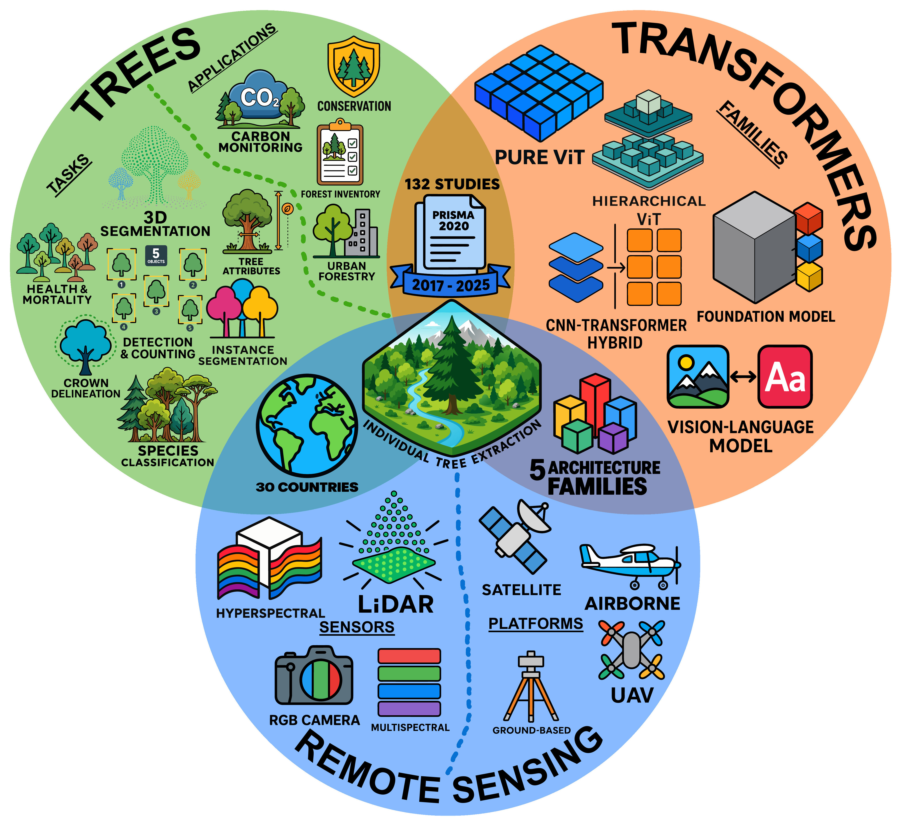</p>

## At a glance

- **Corpus:** 132 studies in 133 reports, selected from 2,522 records (Scopus, Web of Science and arXiv; searches covering 2017 to 2025) and reported following PRISMA 2020.
- **Extraction:** 2,921 results, 853 models and 184 transfer pairs, every value recorded with its page, its location and a verbatim quote.
- **Growth:** studies grew by 640% from 2022 to 2025, and 56.1% appeared in 2025.
- **Against the strongest non-transformer baseline of the same study:** transformers are ahead in 50.7% of 67 studies, tied within one percentage point in 26.9% and behind in 22.4%; median +1.1 pp. The margin is +1.9 pp when the authors propose the transformer and -1.2 pp when it is only a baseline.
- **Domain shift:** only 16.7% of studies test it; median change -5.1 pp.
- **Reporting:** training is not stated in 56.8% of studies; 65.2% use only their own data; 23.5% release code.

## What is in this repository

| Folder | Content |
|---|---|
| `Literature_Extraction/Search/` | arXiv search run and records; the screening log of every record (AI proposal, the author's blind sample and final decisions, full-text decisions); agreement and PRISMA counts |
| `Literature_Extraction/Corpus/papers.csv` | The registry: one row per full-text report, with its IDs, citation key, DOI, decisions and reasons |
| `Literature_Extraction/Extraction/` | The extraction protocol and field dictionary, the dataset registry, one script per paper, the batch workbooks of extracted values, the compiled analysis tables, the cross-check sample and the batch reports |
| `Literature_Extraction/Analysis/figure_data/` | The exact values behind every figure and table, with paper, item and page |
| `Scripts/` | Search, screening, extraction, compilation, figures and the generation of every number |
| `paper/` | What the scripts produce for the manuscript: every number (`generated/numbers.tex`), the tables, the final figures, the bibliography and the reference numbers |
| `reproduce.py` | One command that rebuilds all outputs and checks them against `reproduce_manifest.json` |

## How everything is indexed

Every number in the review can be followed back to a sentence of a source paper:

```
record R#### (screening log)  ->  paper P### (papers.csv)  ->  batch B## and script scripts/B##/P###.py
  ->  value rows with page, location and verbatim quote (batches/B##.xlsx)  ->  compiled tables (compiled/*.csv)
  ->  figure data (Analysis/figure_data/*.csv)  ->  numbers, tables and figures (paper/)
```

- `R####` identifies a database record and `P###` a full-text report; reports of one study share a `study_group`.
- Datasets carry a dataset key (`Extraction/datasets.csv`): a public dataset named by several papers shares one key, and a paper's own data always get their own key.
- Models, results, transfer pairs and data-efficiency points are items within a paper (`model1`, `res12`, ...), tagged as the protocol (`Extraction/protocol.md`) defines.

### AI-assisted workflow

- **Screening:** an AI assistant proposed a title and abstract decision for each record (`ai_decisions.csv`, column `TA_R1` of the screening log). The first author reviewed every proposal and made every final decision (`TA_final`), and independently screened a random sample of 309 records without seeing the proposals (`TA_R2`); agreement 93.2%, Cohen's kappa 0.67 (`screening_agreement.json`). The first author assessed every full text and made every inclusion decision.
- **Extraction:** for each paper, a script drafted with an AI assistant records every value with its page, its location and a verbatim quote (`Extraction/scripts/`). Every value passed automatic checks (the number appears in its quote and the quote on its page, with OCR for pages and tables stored as images).
- **Verification:** the first author cross-validated a random sample against the original papers (`Extraction/crosscheck/`): 200 values, at least one from every report, all correct (189 of them in the final corpus). Not every extracted value was verified individually.
- **Analysis:** every number, table and figure is computed by the scripts in `Scripts/` from the compiled tables.

## Reproduce the analysis

Python 3.11 or newer:

```bash
python -m venv .venv
source .venv/bin/activate        # Windows: .venv\Scripts\activate
pip install -r requirements.txt
python reproduce.py
```

`reproduce.py` compiles the batch workbooks into the analysis tables, recomputes the PRISMA counts and the screening agreement from the screening log, rebuilds every figure and table, regenerates every number, and checks that all data outputs are identical to the published ones. Figures are rebuilt too; their pixels may differ slightly with the fonts installed.

Two steps need the full texts, which cannot be redistributed: re-running a paper script against its PDF text, and the automatic page checks (`Scripts/extraction/kit/`). Their results are published in the workbooks and compiled tables.

## Figures

<details><summary><b>PRISMA 2020 flow diagram</b></summary>

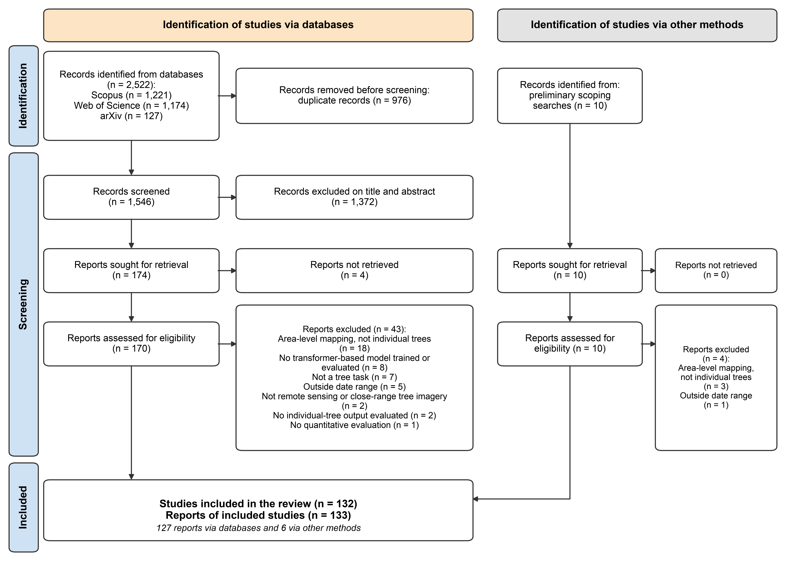
</details>

<details><summary><b>Annotation types, sensors and tasks</b></summary>

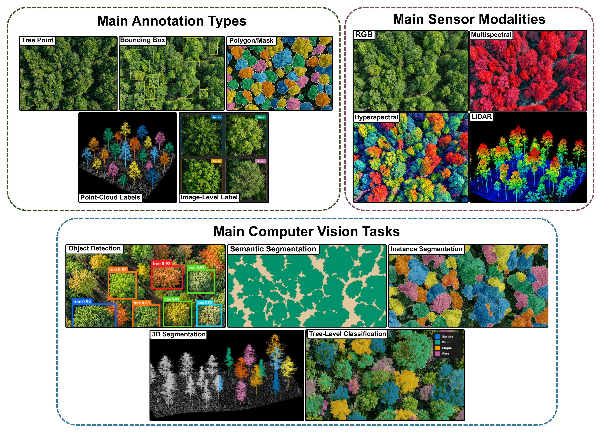
</details>

<details><summary><b>Evidence map: task group by platform, sensor and tree setting</b></summary>

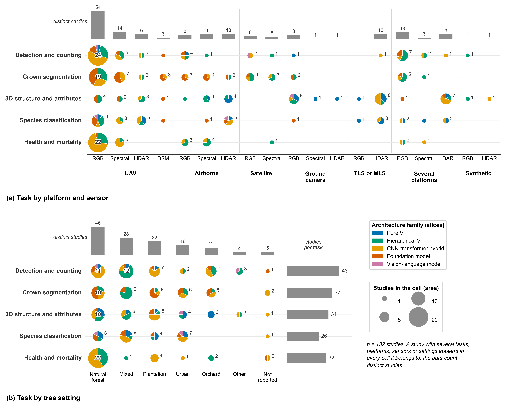
</details>

<details><summary><b>Study areas and biomes</b></summary>

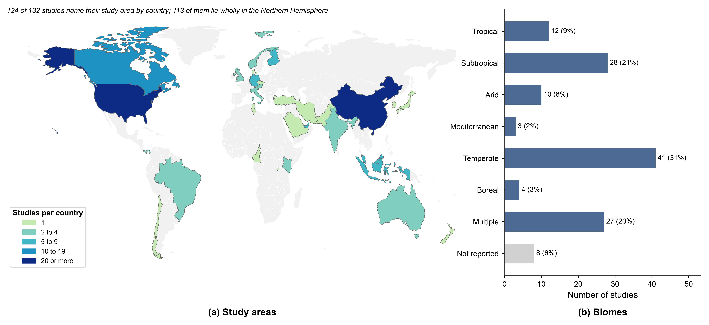
</details>

<details><summary><b>Studies per year by architecture family</b></summary>

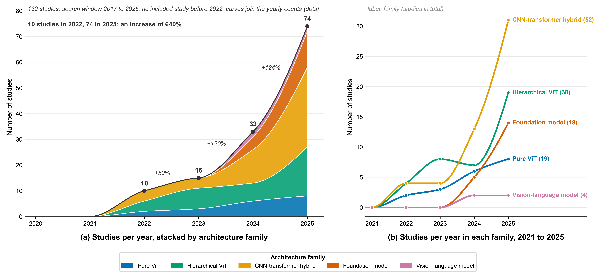
</details>

<details><summary><b>The five architecture families</b></summary>

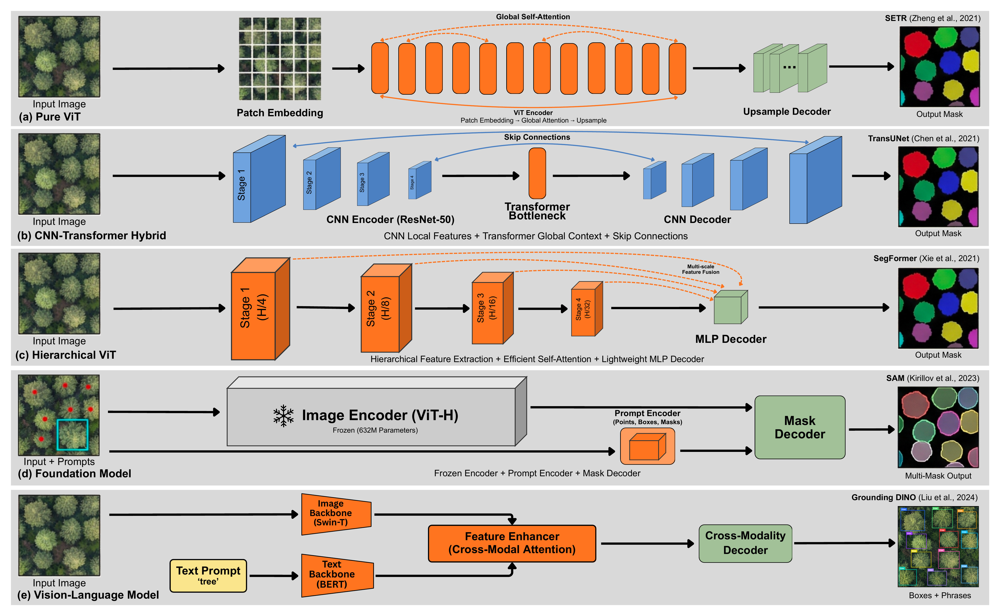
</details>

<details><summary><b>Taxonomy: architecture families and model families</b></summary>

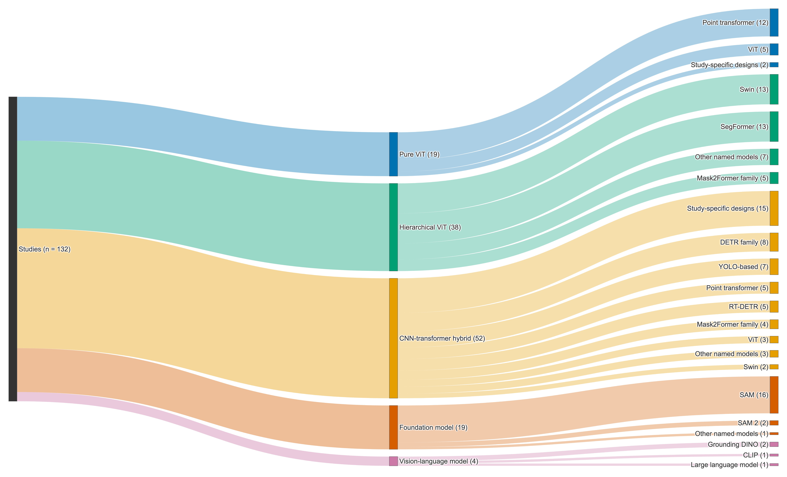
</details>

<details><summary><b>RQ1: transformer against the strongest non-transformer baseline of the same study</b></summary>

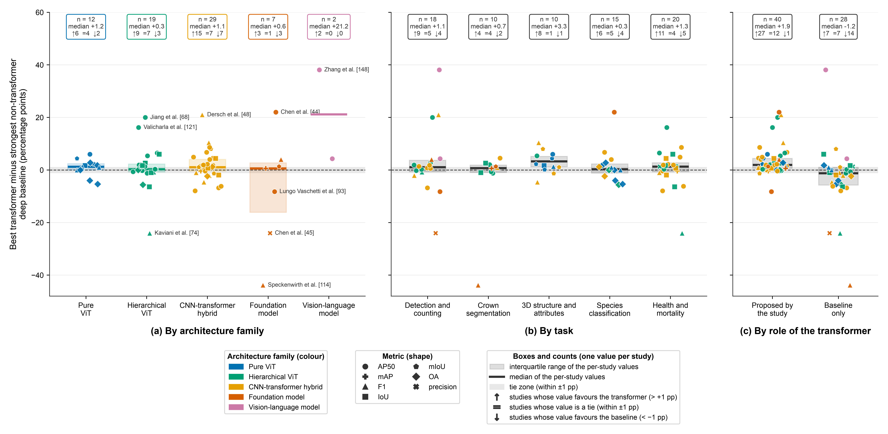
</details>

<details><summary><b>RQ2: change under domain shift</b></summary>

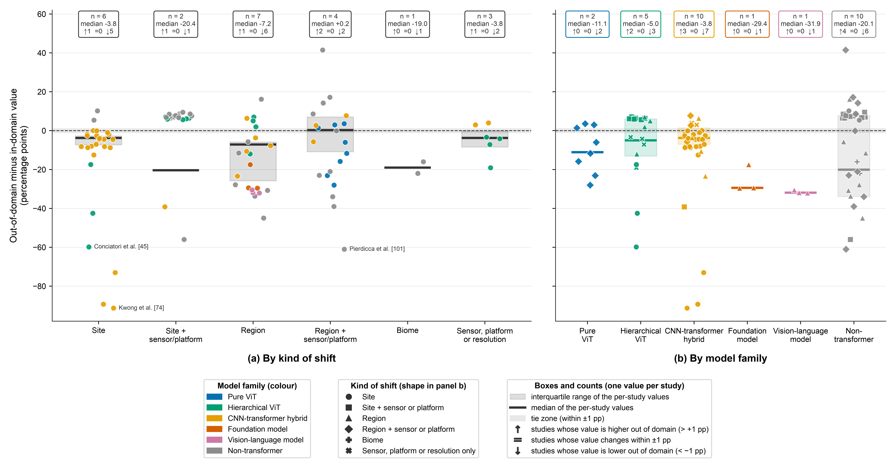
</details>

<details><summary><b>RQ3: training and adaptation</b></summary>

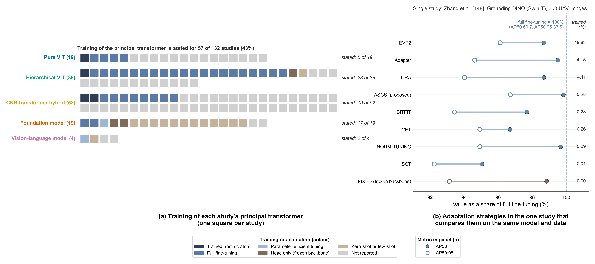
</details>

## Included studies (132)

Grouped by the architecture family of each study's principal transformer. IDs link to the registry and the extraction. Code links are those given in the papers; four that no longer resolve (checked on 19 October 2026) are marked "link unavailable".

<details><summary><b>Pure ViT (19 studies)</b></summary>

| Year | Study | Title | Principal model | Task | Sensors | Code | ID |
|---|---|---|---|---|---|---|---|
| 2025 | Cao et al. (2025) | [A Novel Adaptive Cuboid Regional Growth Algorithm for Trunk–Branch Segmentation of Point Clouds from Two Fruit Tree Species](https://doi.org/10.3390/agriculture15141463) | Point Transformer | 3D structure and attributes | LiDAR | [code](https://github.com/henry3539/ACRGS) | P067 |
| 2025 | Ding et al. (2025) | [WHU-STree: A Multi-modal Benchmark Dataset for Street Tree Inventory](https://doi.org/10.48550/arXiv.2509.13172) | Point Transformer V2 (PTv2) | 3D structure and attributes, Species classification | LiDAR, RGB | [code](https://github.com/WHU-USI3DV/WHU-STree) | P101 |
| 2025 | Hai et al. (2025) | [A Deep Learning-Based Approach to Apple Tree Pruning and Evaluation with Multi-Modal Data for Enhanced Accuracy in Agricultural Practices](https://doi.org/10.3390/agronomy15051242) | Trim-SegTransformer (proposed) | 3D structure and attributes | Hyperspectral |  | P065 |
| 2025 | Jiang et al. (2025a) | [Apple tree architectural trait phenotyping with organ-level instance segmentation from point cloud](https://doi.org/10.1016/j.compag.2024.109708) | Point Transformer V2 (PTv2) | 3D structure and attributes | RGB, LiDAR |  | P069 |
| 2025 | Murray et al. (2025) | [Individual tree species prediction using airborne laser scanning data and derived point-cloud metrics within a dual-stream deep learning approach](https://doi.org/10.1016/j.jag.2025.104877) | Dual-stream model: Point Transformer extractor with Metrics Network | Species classification | LiDAR |  | P111 |
| 2025 | Neyns et al. (2025) | [Deep learning based mapping of bee-friendly trees through remote sensing: A novel approach to enhance pollinator conservation](https://doi.org/10.1016/j.ecoinf.2025.103288) | SAINT (Self-Attention and Intersample Attention Transformer) on PlanetScope time series | Species classification | Multispectral, LiDAR | [code](https://github.com/rneyns/Deep_learning_based_mapping_of-_bee_friendly_trees) | P106 |
| 2025 | Takhtkeshha et al. (2025a) | [3D Forest Semantic Segmentation Using Multispectral LiDAR and 3D Deep Learning](https://doi.org/10.1007/s41064-025-00369-4) | Point Transformer V3 (PTv3) | 3D structure and attributes | LiDAR | link unavailable | P063 |
| 2025 | Xu et al. (2025b) | [SK-TreePCN: Skeleton-Embedded Transformer Model for Point Cloud Completion of Individual Trees from Simulated to Real Data](https://doi.org/10.3390/rs17040656) | SK-TreePCN (AdaPoinTr-based transformer with skeleton modules) with AdTree reconstruction | 3D structure and attributes | LiDAR |  | P092 |
| 2024 | Grondin et al. (2024) | [Leveraging Prompt-Based Segmentation Models and Large Dataset to Improve Detection of Trees](https://doi.org/10.21428/d82e957c.88589b5f) | ViTDet trained on FlickrTree110K pseudo-labels refined by SAM (CanaTree burn-in) | 3D structure and attributes, Detection and counting | RGB | [code](https://github.com/norlab-ulaval/PercepTreeV1) | P019 |
| 2024 | Huang et al. (2024) | [Tree Species Classification from UAV Canopy Images with Deep Learning Models](https://doi.org/10.3390/rs16203836) | Vision Transformer (ViT) | Species classification | RGB |  | P118 |
| 2024 | Lin et al. (2024) | [PCTreeS: 3D Point Cloud Tree Species Classification Using Airborne LiDAR Images](https://doi.org/10.48550/ARXIV.2412.04714) | PCTreeS (Point Cloud Transformer for tree species classification, proposed) | Species classification | LiDAR | [code](https://github.com/mattynaz/pctrees) | P115 |
| 2024 | Lu et al. (2024b) | [PosE-Enhanced Point Transformer with Local Surface Features (LSF) for Wood–Leaf Separation](https://doi.org/10.3390/f15122244) | Enhanced PT (PT with LSF and PosE, proposed) | 3D structure and attributes | LiDAR |  | P088 |
| 2024 | Ton-That et al. (2024) | [Expanding Vision in Tree Counting: Novel Ground Truth Generation and Deep Learning Model](https://doi.org/10.1109/icce62051.2024.10634677) | TreeVision | Detection and counting | RGB |  | P014 |
| 2024 | Yang et al. (2024) | [An Improved Method for Individual Tree Segmentation in Complex Urban Scenes Based on Using Multispectral LiDAR by Deep Learning](https://doi.org/10.1109/JSTARS.2024.3373395) | Point Transformer (tree point extraction) | 3D structure and attributes | LiDAR, Multispectral |  | P068 |
| 2023 | Pierdicca et al. (2023) | [UAV4TREE: DEEP LEARNING-BASED SYSTEM FOR AUTOMATIC CLASSIFICATION OF TREE SPECIES USING RGB OPTICAL IMAGES OBTAINED BY AN UNMANNED AERIAL VEHICLE](https://doi.org/10.5194/isprs-annals-X-1-W1-2023-1089-2023) | Vision Transformer B16 | Species classification | RGB |  | P121 |
| 2023 | Sun et al. (2023) | [Classification of Individual Tree Species Using UAV LiDAR Based on Transformer](https://doi.org/10.3390/f14030484) | Point Cloud Transformer (PCT) | Species classification | LiDAR |  | P105 |
| 2023 | Zhang et al. (2023) | [Towards Intricate Stand Structure: A Novel Individual Tree Segmentation Method for ALS Point Cloud Based on Extreme Offset Deep Learning](https://doi.org/10.3390/app13116853) | Extreme offset network (Point Transformer) with dynamic-bandwidth mean shift and ITS set aggregation (proposed) | 3D structure and attributes | LiDAR |  | P096 |
| 2022 | Liu et al. (2022) | [Tree Species Classification Using Ground-Based LiDAR Data by Various Point Cloud Deep Learning Methods](https://doi.org/10.3390/rs14225733) | PCT | Species classification | LiDAR |  | P120 |
| 2022 | Luo et al. (2022) | [Individual tree detection in coal mine afforestation area based on improved faster RCNN in UAV RGB images](https://doi.org/10.3390/rs14215545) | ViDT | Detection and counting | RGB |  | P017 |

</details>

<details><summary><b>Hierarchical ViT (38 studies)</b></summary>

| Year | Study | Title | Principal model | Task | Sensors | Code | ID |
|---|---|---|---|---|---|---|---|
| 2025 | Begum et al. (2025) | [Sustainable Forestry: AI-Driven Forest Health Diagnostics using Swin Transformer](https://doi.org/10.1109/AMATHE65477.2025.11080823) | SWIN Transformer | Health and mortality | RGB |  | P149 |
| 2025 | Gibril et al. (2025) | [Efficient Large-scale Mapping of Acacia Tortilis Trees Using UAV-based Images and Transformer-based Semantic Segmentation Architectures](https://doi.org/10.5194/isprs-annals-X-G-2025-285-2025) | Mask2Former with DaViT-tiny backbone | Crown segmentation | RGB |  | P040 |
| 2025 | Jiang et al. (2025b) | [Detection transformer-based approach for mapping trees outside forests on high resolution satellite imagery](https://doi.org/10.1016/j.ecoinf.2025.103114) | DINO-SWIN | Detection and counting | Multispectral | [code](https://github.com/Taoorwell/TOF_Detection/) | P013 |
| 2025 | Joshi and Witharana (2025) | [Vision Transformer-Based Unhealthy Tree Crown Detection in Mixed Northeastern US Forests and Evaluation of Annotation Uncertainty](https://doi.org/10.3390/rs17061066) | SegFormer-B0 | Health and mortality | Multispectral |  | P152 |
| 2025 | Kaviani et al. (2025) | [Tree Health Assessment Using Mask R-CNN on UAV Multispectral Imagery over Apple Orchards](https://doi.org/10.3390/rs17193369) | Mask R-CNN with Swin Transformer (Base) | Detection and counting, Health and mortality | Multispectral |  | P150 |
| 2025 | Li et al. (2025d) | [Multimodal Foundation Models as Router Models for High-Resolution Aerial Image Segmentation](https://doi.org/10.1109/ICDMW69685.2025.00385) | Mask2Former (Gemini MARS) | Health and mortality | RGB, Multispectral |  | P143 |
| 2025 | Lv et al. (2025) | [Monitoring Pine Wilt Disease Using High-Resolution Satellite Remote Sensing at the Single-Tree Scale with Integrated Self-Attention](https://doi.org/10.3390/rs17132197) | SegFormer-b2 | Health and mortality | Multispectral |  | P142 |
| 2025 | Movchan et al. (2025) | [UAV-Based Wellsite Reclamation Monitoring Using Transformer-Based Deep Learning on Multi-Seasonal LiDAR and Multispectral Data](https://doi.org/10.3390/rs17203440) | TreeLoc (3D-SegFormer for treetop locations) | 3D structure and attributes, Detection and counting, Species classification | LiDAR, Multispectral, RGB | [code](https://github.com/NRCan/TreeAIBox) | P099 |
| 2025 | Möhring et al. (2025) | [Global, multi-scale standing deadwood segmentation in centimeter-scale aerial images](https://doi.org/10.1016/j.ophoto.2025.100104) | SegFormer-B5 with U-Net decoder | Health and mortality | RGB | link unavailable | P140 |
| 2025 | Shanableh et al. (2025) | [A comparative analysis of deep learning methods for ghaf tree detection and segmentation from uav-based images](https://doi.org/10.5194/isprs-annals-x-g-2025-805-2025) | Mask R-CNN with Swin Transformer backbone | Crown segmentation, Detection and counting | RGB |  | P001 |
| 2025 | Sharifi et al. (2025) | [Multi-Sensor AI-Based Urban Tree Crown Segmentation from High-Resolution Satellite Imagery for Smart Environmental Monitoring](https://doi.org/10.3390/smartcities8060187) | SegFormer (MiT-B2) | Crown segmentation | RGB, Multispectral |  | P052 |
| 2025 | Shendryk and Vilas (2025) | [Detecting mangrove seedlings from UAV imagery using deep learning for restoration monitoring](https://doi.org/10.1038/s41598-025-30387-6) | MaxViT-UNet density estimation | Detection and counting | RGB |  | P012 |
| 2025 | Takhtkeshha et al. (2025b) | [Multispectral LiDAR data for extracting tree points in urban and suburban areas](https://doi.org/10.48550/ARXIV.2508.19881) | Superpoint Transformer (SPT) | 3D structure and attributes | LiDAR, Multispectral | link unavailable | P086 |
| 2025 | Wang et al. (2025a) | [Fine-grained individual tree crown segmentation based on high-resolution images](https://doi.org/10.5194/isprs-archives-XLVIII-G-2025-1529-2025) | HTC with CB-Swin-B backbone | Crown segmentation | RGB |  | P044 |
| 2025 | Wang et al. (2025b) | [TreeFinder: A US-Scale Benchmark Dataset for Individual Tree Mortality Monitoring Using High-Resolution Aerial Imagery](https://doi.org/10.52202/085713-5526) | Mask2Former | Health and mortality | RGB, Multispectral | [code](https://github.com/zhwang0/treefinder) | P151 |
| 2025 | Wu et al. (2025a) | [A lightweight segmentation model toward timely processing for identification of pine wood nematode affected trees with UAV](https://doi.org/10.1186/s13007-025-01385-6) | Swin-UNet | Crown segmentation, Health and mortality | RGB | [code](https://github.com/ib00r/RCANet) | P125 |
| 2025 | Yu et al. (2025a) | [Efficient Application of the Deep Learning-Driven SGS-3DRecon Framework in Large-Scale Forest Surveys Under Complex Scenarios](https://doi.org/10.1109/TGRS.2025.3594251) | SGS-3DRecon (SegFormer, GAN inversion and Sobel refinement) | 3D structure and attributes | RGB |  | P074 |
| 2025 | Yu et al. (2025b) | [Single-image estimation of tree volume via pixel-mapped 3D reconstruction: A low-cost solution using deep learning and curvature segmentation](https://doi.org/10.1016/j.scitotenv.2025.180420) | SegFormer trunk segmentation within the PMPE framework | 3D structure and attributes | RGB |  | P091 |
| 2025 | Zhou et al. (2025) | [Semantic-Aware Cross-Modal Transfer for UAV-LiDAR Individual Tree Segmentation](https://doi.org/10.3390/rs17162805) | MSFFNet with MiT-B4 (SegFormer) encoder | 3D structure and attributes, Crown segmentation | RGB, LiDAR |  | P090 |
| 2024 | Al-Ruzouq et al. (2024) | [Spectral–Spatial transformer-based semantic segmentation for large-scale mapping of individual date palm trees using very high-resolution satellite data](https://doi.org/10.1016/j.ecolind.2024.112110) | UperNet with Swin-tiny backbone | Crown segmentation | RGB, Multispectral | [code](https://github.com/Bolci/Palm_Extraction_Tools/tree/main) | P056 |
| 2024 | Amirkolaee et al. (2024) | [AdaTreeFormer: Few shot domain adaptation for tree counting from a single high-resolution image](https://doi.org/10.1016/j.isprsjprs.2024.06.015) | AdaTreeFormer | Detection and counting | RGB | [code](https://github.com/HAAClassic/AdaTreeFormer) | P005 |
| 2024 | Arevalo-Ramirez et al. (2024) | [Exploring the Potential of Reconstructed Multispectral Images for Urban Tree Segmentation in Street View Images](https://doi.org/10.1109/JSTARS.2024.3419127) | SegFormer (MiT-B0) | Crown segmentation | RGB |  | P043 |
| 2024 | Conciatori et al. (2024) | [Plant Species Classification and Biodiversity Estimation from UAV Images with Deep Learning](https://doi.org/10.3390/rs16193654) | Swin Transformer (tiny) | Species classification | RGB |  | P116 |
| 2024 | Gibril et al. (2024) | [Large-scale assessment of date palm plantations based on UAV remote sensing and multiscale vision transformer](https://doi.org/10.1016/j.rsase.2024.101195) | Mask R-CNN with MViTv2-tiny backbone (improved MViTv2 with FPN) | Crown segmentation, Detection and counting, Health and mortality | RGB |  | P018 |
| 2024 | Lu et al. (2024a) | [M2fnet: Multi-modal forest monitoring network on large-scale virtual dataset](https://doi.org/10.1109/vrw62533.2024.00104) | M2fNet (RGB and depth) | 3D structure and attributes, Detection and counting | RGB |  | P020 |
| 2024 | Xi et al. (2024) | [Supervised terrestrial to airborne laser scanner model calibration for 3D individual-tree attribute mapping using deep neural networks](https://doi.org/10.1016/j.isprsjprs.2024.02.010) | SegFormer (3D voxel version) tree point classifier (proposed) | 3D structure and attributes | LiDAR | [code](https://github.com/truebelief/artemis_treescaling) | P094 |
| 2023 | Amirkolaee et al. (2023) | [TreeFormer: A Semi-Supervised Transformer-Based Framework for Tree Counting From a Single High-Resolution Image](https://doi.org/10.1109/TGRS.2023.3295802) | S-TreeFormer (supervised) | Detection and counting | RGB | [code](https://github.com/HAAClassic/TreeFormer) | P030 |
| 2023 | Gibril et al. (2023) | [Large-Scale Date Palm Tree Segmentation from Multiscale UAV-Based and Aerial Images Using Deep Vision Transformers](https://doi.org/10.3390/drones7020093) | SegFormer (MiT-B2) trained on UAV data | Crown segmentation | RGB |  | P051 |
| 2023 | Gominski et al. (2023) | [Benchmarking individual tree mapping with sub-meter imagery](https://doi.org/10.48550/arXiv.2311.07981) | Heatmap framework with SegFormer | 3D structure and attributes, Detection and counting | RGB, Multispectral |  | P010 |
| 2023 | Jiang et al. (2023) | [A multi-scale approach to detecting standing dead trees in UAV RGB images based on improved faster R-CNN](https://doi.org/10.1371/journal.pone.0281084) | Improved Faster R-CNN (Swin Transformer backbone, balance feature enhancement and dynamic training, proposed) | Health and mortality | RGB |  | P126 |
| 2023 | Valicharla et al. (2023) | [Precision Detection and Assessment of Ash Death and Decline Caused by the Emerald Ash Borer Using Drones and Deep Learning](https://doi.org/10.3390/plants12040798) | Mask2Former with Swin-S backbone | Health and mortality | RGB |  | P145 |
| 2023 | Wang et al. (2023a) | [More appropriate DenseNetBL classifier for small sample tree species classification using UAV-based RGB imagery](https://doi.org/10.1016/j.heliyon.2023.e20467) | Swin Transformer (small) | Species classification | RGB |  | P113 |
| 2023 | Xi et al. (2023) | [Delineating and Reconstructing 3D Forest Fuel Components and Volumes with Terrestrial Laser Scanning](https://doi.org/10.3390/rs15194778) | SegFormer (3D voxel version) with stem isolation, tree clustering and QSM | 3D structure and attributes | LiDAR |  | P073 |
| 2023 | Yang et al. (2023) | [INSTANCE SEGMENTATION OF LIDAR DATA WITH VISION TRANSFORMER MODEL IN SUPPORT INUNDATION MAPPING UNDER FOREST CANOPY ENVIRONMENT](https://doi.org/10.5194/isprs-archives-XLVIII-1-W2-2023-203-2023) | Mask2Former with Swin Transformer backbone | Crown segmentation | LiDAR |  | P082 |
| 2022 | Alshammari and Shahin (2022) | [An efficient deep learning mechanism for the recognition of olive trees in Jouf Region](https://doi.org/10.1155/2022/9249530) | SwinTU-net | Crown segmentation, Detection and counting | RGB, Multispectral |  | P008 |
| 2022 | Gibril et al. (2022) | [Deep convolutional neural networks and Swin transformer-based frameworks for individual date palm tree detection and mapping from large-scale UAV images](https://doi.org/10.1080/10106049.2022.2142966) | Mask R-CNN with Swin-small-FPN backbone | Crown segmentation, Detection and counting | RGB |  | P011 |
| 2022 | Lan et al. (2022) | [Real-Time UAV Patrol Technology in Orchard Based on the Swin-T YOLOX Lightweight Model](https://doi.org/10.3390/rs14225806) | Swin-T YOLOX | Detection and counting, Health and mortality | RGB |  | P148 |
| 2022 | Zhang et al. (2022) | [Individual tree detection based on high-resolution RGB images for urban forestry applications](https://doi.org/10.1109/access.2022.3171585) | Faster R-CNN with Swin-T backbone | Detection and counting | RGB |  | P016 |

</details>

<details><summary><b>CNN-transformer hybrid (52 studies)</b></summary>

| Year | Study | Title | Principal model | Task | Sensors | Code | ID |
|---|---|---|---|---|---|---|---|
| 2025 | Al-Saad et al. (2025) | [Benchmark Dataset for AI-Driven Palm Tree Detection and Analysis in the UAE](https://doi.org/10.5194/isprs-annals-x-g-2025-95-2025) | DETR | Detection and counting | RGB |  | P009 |
| 2025 | Chen et al. (2025b) | [PWDViTNet: A lightweight early pine wilt disease detection model based on the fusion of ViT and CNN](https://doi.org/10.1016/j.compag.2025.109910) | PWDViTNet (Ours) | Health and mortality | RGB |  | P146 |
| 2025 | Dewi et al. (2025) | [Evaluation of YOLOv11 and RF-DETR Architectures for UAV-Based Detection of Healthy Oil Palm Trees](https://doi.org/10.1109/IC2IE67206.2025.11283417) | RF-DETR-base | Health and mortality | RGB |  | P138 |
| 2025 | Du et al. (2025) | [VSLNet: Multimodal Data Fusion Network for Tree Species Classification in Overhead Transmission Line Corridors](https://doi.org/10.1109/TII.2024.3459014) | VSLNet with SSC fusion | Species classification | RGB, Multispectral, LiDAR |  | P122 |
| 2025 | Durgut and Ünsalan (2025) | [Multi-model tree detection in satellite images with weighted boxes fusion](https://doi.org/10.1007/s11760-024-03722-z) | WBF fusion of M1 and M3 (swin transformer and RCNN) | Detection and counting | RGB |  | P023 |
| 2025 | Ghazali et al. (2025) | [RT-DETR-Palm A Transformer Based Approach for Oil Palm Tree Detection Using UAV Imagery](https://doi.org/10.1109/ICATEI67676.2025.11404965) | RT-DETR-Palm | Detection and counting | RGB |  | P026 |
| 2025 | Jung et al. (2025) | [Individual Tree Biomass Estimation using Single-Scan Terrestrial Laser Scanner with Efficient Projection-Based Deep Learning](https://doi.org/10.1007/s44392-025-00065-6) | CoAtNet-based framework (3D-to-2D projection, augmentation and ensemble) | 3D structure and attributes | LiDAR | [code](https://github.com/gdslab/agbm_tls_dl) | P080 |
| 2025 | Kang (2025) | [Estimating the vitality of individual street trees in urban areas using multi-source imagery and deep learning](https://doi.org/10.1145/3748636.3766531) | Mask2Former | Detection and counting, Health and mortality | RGB, Multispectral |  | P137 |
| 2025 | Li and Chen (2025) | [Lightweight vision transformer model for pine wilt disease detection using aerial RGB image and adversarial data augmentation](https://doi.org/10.1016/j.atech.2025.101167) | FCL-RTDETR (our) | Health and mortality | RGB |  | P141 |
| 2025 | Li et al. (2025a) | [Detection of pine wilt disease across early, middle, and late stages using dual-scale interaction method](https://doi.org/10.1080/01431161.2025.2564905) | DSI-YOLOv5 | Health and mortality | RGB |  | P134 |
| 2025 | Li et al. (2025b) | [Fuzzy Boundary-Aware Network for Hyperspectral Individual Tree Fine Recognition](https://doi.org/10.1109/TGRS.2025.3582412) | FBAN (proposed) | Crown segmentation, Species classification | Hyperspectral |  | P108 |
| 2025 | Li et al. (2025c) | [MRV-YOLO: A Multi-Channel Remote Sensing Object Detection Method for Identifying Reclaimed Vegetation in Hilly and Mountainous Mining Areas](https://doi.org/10.3390/f16101536) | RT-DETR | Detection and counting | RGB, Multispectral |  | P021 |
| 2025 | Liu et al. (2025a) | [A Multifeature Fusion Network for Tree Species Classification Based on Ground-Based LiDAR Data](https://doi.org/10.1109/JSTARS.2025.3527808) | MFFTC-Net (proposed) | Species classification | LiDAR |  | P102 |
| 2025 | Liu et al. (2025b) | [Research on Tree Point Cloud Enhancement Based on Deep Learning](https://doi.org/10.3390/f16060915) | Species classifier trained with the proposed completion and adversarial augmentation (ours) | Species classification | LiDAR |  | P089 |
| 2025 | Ma et al. (2025) | [Efficient Urban Tree Species Classification via Multirepresentation Fusion of Mobile Laser Scanning Data](https://doi.org/10.1109/JSTARS.2025.3560714) | PoinTramba | Species classification | LiDAR |  | P107 |
| 2025 | Maulana et al. (2025) | [Real Time End-To-End Spatial-Frequency Detr for Monitoring Growing Status of Oil Palm Tree](https://doi.org/10.1109/ICONS-IoT65216.2025.11211477) | CoFA-DETR-R50 (ours) | Health and mortality | RGB |  | P147 |
| 2025 | Rahman et al. (2025) | [Dual-task learning for dead tree detection and segmentation with hybrid self-attention U-Nets in aerial imagery](https://doi.org/10.1016/j.jag.2025.104851) | MaskFormer | Crown segmentation, Health and mortality | RGB, Multispectral | [code](https://github.com/Global-Ecosystem-Health-Observatory/TreeMort) | P135 |
| 2025 | Rodrigues et al. (2025) | [3D Point Cloud Segmentation of LiDAR-Scanned Eucalyptus Trees: a Deep Learning Analysis](https://doi.org/10.1109/CCECE64018.2025.11364465) | Point Voxel Transformer (PVT) | 3D structure and attributes | LiDAR |  | P064 |
| 2025 | Saputra et al. (2025) | [Oil Palm Condition Monitoring via UAV Imagery Using YOLOv11 Enhanced for Class Imbalance](https://doi.org/10.1109/ICITEE66631.2025.11338374) | Deformable DETR | Health and mortality |  |  | P144 |
| 2025 | Shi et al. (2025) | [YOLOv8-MFD: An Enhanced Detection Model for Pine Wilt Diseased Trees Using UAV Imagery](https://doi.org/10.3390/s25113315) | YOLOv8-MFD (proposed) | Health and mortality | RGB |  | P153 |
| 2025 | Stone et al. (2025) | [Generating Synthetic Tree Point Clouds for Deep Learning Applications in Remote Sensing](https://doi.org/10.1007/978-3-031-77389-1_1) | Point-Voxel Transformer (PVT) | 3D structure and attributes | LiDAR | yes | P079 |
| 2025 | Wu et al. (2025b) | [Algorithm for Detecting Trees Affected by Pine Wilt Disease in Complex Scenes Based on CNN-Transformer](https://doi.org/10.3390/f16040596) | EVitNet (lightweight ViT encoder and CNN decoder, proposed) | Crown segmentation, Health and mortality | RGB | [code](https://github.com/ib00r/EVitNet) | P129 |
| 2025 | Xi and Degenhardt (2025) | [A new unified framework for supervised 3D crown segmentation (TreeisoNet) using deep neural networks across airborne, UAV-borne, and terrestrial laser scans](https://doi.org/10.1016/j.ophoto.2025.100083) | TreeisoNet (hands-off: 3D-SegFormer and 3D U-Net modules in sequence) | 3D structure and attributes, Detection and counting | LiDAR | [code](https://github.com/truebelief/cc-TreeAIBox-plugin) | P066 |
| 2025 | Xiang et al. (2025) | [ForestFormer3D: A Unified Framework for End-to-End Segmentation of Forest LiDAR 3D Point Clouds](https://doi.org/10.1109/ICCV51701.2025.02292) | ForestFormer3D | 3D structure and attributes | LiDAR | [code](https://bxiang233.github.io/FF3D/) | P078 |
| 2025 | Xiu et al. (2025) | [Individual tree extraction through 3D promptable segmentation networks](https://doi.org/10.1111/2041-210X.70057) | 3DPS-Net trained on Plot 1 (Model 1) | 3D structure and attributes | LiDAR | [code](https://doi.org/10.5281/zenodo.15245851) | P081 |
| 2025 | Xu et al. (2025a) | [FIDC-YOLO: Improved YOLO for Detecting Pine Wilt Disease in UAV Remote Sensing Images via Feature Interaction and Dependency Capturing](https://doi.org/10.1109/JSTARS.2025.3573741) | RT-DETR | Detection and counting, Health and mortality | RGB |  | P139 |
| 2025 | Yan et al. (2025) | [TM-WSNet: A precise segmentation method for individual rubber trees based on UAV LiDAR point cloud](https://doi.org/10.1016/j.plaphe.2025.100093) | TM-WSNet (proposed) | 3D structure and attributes | LiDAR |  | P095 |
| 2025 | Zeng et al. (2025) | [FO-Net: An advanced deep learning network for individual tree identification using UAV high-resolution images](https://doi.org/10.1016/j.isprsjprs.2024.12.020) | FO-Net | Detection and counting | RGB |  | P015 |
| 2025 | Zhang and Zhou (2025) | [A UAV Detection Method Based on Adaptive Multi-Scale Feature Fusion for Bayberry Tree](https://doi.org/10.1109/icmlca66850.2025.11336681) | ADME-DETR | Detection and counting | RGB |  | P004 |
| 2025 | Zhang et al. (2025a) | [MTCDNet: Multimodal Feature Fusion-Based Tree Crown Detection Network Using UAV-Acquired Optical Imagery and LiDAR Data](https://doi.org/10.3390/rs17121996) | MTCDNet | Detection and counting | RGB, LiDAR |  | P022 |
| 2025 | Zhang et al. (2025c) | [TreegrowNet: a completion network for incomplete single tree point cloud from TLS](https://doi.org/10.1080/01431161.2024.2440134) | TreegrowNet (proposed) | 3D structure and attributes | LiDAR |  | P098 |
| 2024 | Dai et al. (2024) | [CPH-Fmnet: An Optimized Deep Learning Model for Multi-View Stereo and Parameter Extraction in Complex Forest Scenes](https://doi.org/10.3390/f15111860) | CPH-Fmnet | 3D structure and attributes | RGB |  | P072 |
| 2024 | Feng et al. (2024) | [Security of target recognition for UAV forestry remote sensing based on multi-source data fusion transformer framework](https://doi.org/10.1016/j.inffus.2024.102555) | SC-RTDETR | Detection and counting, Health and mortality | RGB |  | P027 |
| 2024 | He et al. (2024) | [Parallel Fusion Neural Network Considering Local and Global Semantic Information for Citrus Tree Canopy Segmentation](https://doi.org/10.1109/JSTARS.2023.3339290) | Proposed parallel fusion network (EfficientNet-V2 and CSwin) | Crown segmentation | RGB, DSM |  | P054 |
| 2024 | Kwong et al. (2024) | [Enhancing oil palm segmentation model with GAN-based augmentation](https://doi.org/10.1186/s40537-024-00990-x) | DETR GAN palm model | Crown segmentation, Detection and counting | RGB |  | P041 |
| 2024 | Li et al. (2024) | [A spatio-temporal multi-scale fusion algorithm for pine wood nematode disease tree detection](https://doi.org/10.1007/s11676-024-01754-2) | Improved YOLOv8 (MHSA, SPD-Conv, GD neck, Focal-EIoU) | Detection and counting, Health and mortality | RGB |  | P127 |
| 2024 | Liu et al. (2024a) | [Clusterformer for Pine Tree Disease Identification Based on UAV Remote Sensing Image Segmentation](https://doi.org/10.1109/TGRS.2024.3362877) | Clusterformer (proposed) | Crown segmentation, Health and mortality | RGB, Multispectral | [code](https://github.com/huanliu233/Clusterformer) | P130 |
| 2024 | Wang et al. (2024) | [Individual tree species classification using low-density airborne multispectral LiDAR data via attribute-aware cross-branch transformer](https://doi.org/10.1016/j.rse.2024.114456) | AACB Transformer (Attribute-Aware Cross-Branch Transformer, proposed) | Species classification | LiDAR |  | P110 |
| 2024 | Xie et al. (2024) | [Early-Stage Pine Wilt Disease Detection via Multi-Feature Fusion in UAV Imagery](https://doi.org/10.3390/f15010171) | DETR (Res101) | Health and mortality | RGB |  | P136 |
| 2024 | Yuan et al. (2024) | [A Lightweight Pine Wilt Disease Detection Method Based on Vision Transformer-Enhanced YOLO](https://doi.org/10.3390/f15061050) | Light-ViTeYOLO (EfficientViT-YOLOv5 with CACSNet neck and EIoU loss, proposed) | Health and mortality | RGB |  | P124 |
| 2024 | Zhang and Liu (2024) | [Double-Branch Multi-Scale Contextual Network: A Model for Multi-Scale Street Tree Segmentation in High-Resolution Remote Sensing Images](https://doi.org/10.3390/s24041110) | DB-MSC Net | Crown segmentation | RGB, Multispectral |  | P039 |
| 2024 | Zhang et al. (2024) | [SPTNet: Sparse Convolution and Transformer Network for Woody and Foliage Components Separation From Point Clouds](https://doi.org/10.1109/TGRS.2024.3376454) | SPTNet (sparse convolution and transformer blocks, proposed) | 3D structure and attributes | LiDAR |  | P093 |
| 2024 | Zhu et al. (2024a) | [CEDAnet: Individual Tree Segmentation in Dense Orchard via Context Enhancement and Density Prior](https://doi.org/10.1109/JSTARS.2024.3378167) | CEDAnet | Crown segmentation, Detection and counting | RGB | [code](https://github.com/Lihy256/CEDAnet) | P036 |
| 2024 | Zhu et al. (2024b) | [Transformer-based Instance Segmentation with Multi-Scale Spectrum-Averaging Blend Queries](https://doi.org/10.1109/ISCIPT61983.2024.10673075) | Spec-Mask2former | Crown segmentation, Species classification | RGB |  | P058 |
| 2023 | Dersch et al. (2023) | [Towards complete tree crown delineation by instance segmentation with Mask R–CNN and DETR using UAV-based multispectral imagery and lidar data](https://doi.org/10.1016/j.ophoto.2023.100037) | DETR (panoptic segmentation head) | Crown segmentation | Multispectral, LiDAR |  | P057 |
| 2023 | Qin et al. (2023) | [Deep Learning-Based Pine Nematode Trees’ Identification Using Multispectral and Visible UAV Imagery](https://doi.org/10.3390/drones7030183) | Improved YOLOv5l (GhostNet, CBAM and CA, transformer encoder, BiFPN) | Detection and counting, Health and mortality | RGB, Multispectral |  | P132 |
| 2023 | Wang et al. (2023b) | [Tree Species Classfifcation Using Deep Learning Based 3d Point Cloud Transformer on Airborne Lidar Data](https://doi.org/10.1109/IGARSS52108.2023.10282813) | 3DPCT (3D Point Cloud Transformer with dual self-attention) | Species classification | LiDAR |  | P117 |
| 2023 | Zhou et al. (2023) | [Mapping of Rubber Forest Growth Models Based on Point Cloud Data](https://doi.org/10.3390/rs15215083) | Improved PointPillars with multi-scale pillar features and a Swin Transformer module | 3D structure and attributes, Detection and counting | LiDAR |  | P083 |
| 2022 | Chen and Shang (2022) | [Transformer for Tree Counting in Aerial Images](https://doi.org/10.3390/rs14030476) | DENT-DMG (density transformer, density map generator head) | Detection and counting | RGB |  | P029 |
| 2022 | Dersch et al. (2022) | [NOVEL SINGLE TREE DETECTION BY TRANSFORMERS USING UAV-BASED MULTISPECTRAL IMAGERY](https://doi.org/10.5194/isprs-archives-XLIII-B2-2022-981-2022) | DETR | Detection and counting | RGB |  | P024 |
| 2022 | Li et al. (2022) | [Detecting pine wilt disease at the pixel level from high spatial and spectral resolution UAV-borne imagery in complex forest landscapes using deep one-class classification](https://doi.org/10.1016/j.jag.2022.102947) | Proposed deep OCC model (3D convolutional layers and transformer blocks, balanced unbiased risk) | Health and mortality | Hyperspectral |  | P133 |
| 2022 | Zhou et al. (2022) | [A Detection Method for Individual Infected Pine Trees with Pine Wilt Disease Based on Deep Learning](https://doi.org/10.3390/f13111880) | MFTD (YOLOv5s, visible and red-band fusion) | Health and mortality | RGB, Multispectral |  | P123 |

</details>

<details><summary><b>Foundation model (19 studies)</b></summary>

| Year | Study | Title | Principal model | Task | Sensors | Code | ID |
|---|---|---|---|---|---|---|---|
| 2025 | Ambarwari et al. (2025) | [Domain-Aware Transfer Learning With SAM-Assisted Mask R-CNN for Urban Tree Crown Delineation From UAV Orthophotos](https://doi.org/10.1109/ACCESS.2025.3619949) | SAM-HQ (ViT-H Quant) | Crown segmentation | RGB |  | P038 |
| 2025 | Bountos et al. (2025) | [FoMo: Multi-Modal, Multi-Scale and Multi-Task Remote Sensing Foundation Models for Forest Monitoring](https://doi.org/10.1609/aaai.v39i27.35002) | Faster R-CNN (FoMo-Net1) | Detection and counting | RGB | [code](https://github.com/RolnickLab/FoMo-Bench) | P154 |
| 2025 | Buchner et al. (2025) | [How precise is precise enough? Tree crown segmentation using high resolution close-up multispectral UAV images and its effect on NDVI accuracy in Fraxinus excelsior L. trees](https://doi.org/10.1007/s11676-025-01929-5) | Coarse segmentation (pre-trained SAM, one point prompt) | Crown segmentation | RGB, Multispectral |  | P049 |
| 2025 | Chen et al. (2025a) | [A Two-Stage Segment-Then-Classify Strategy for Accurate Ginkgo Tree Identification from UAV Imagery](https://doi.org/10.3390/drones9110773) | STC (SAM canopy segmentation then ResNet-101 classification, proposed) | Species classification | RGB |  | P103 |
| 2025 | Chen et al. (2025c) | [Zero-Shot Tree Detection and Segmentation from Aerial Forest Imagery](https://doi.org/10.48550/ARXIV.2506.03114) | SAM2 (automatic mask generator, zero-shot) | Crown segmentation, Detection and counting | RGB | [code](https://github.com/open-forest-observatory/tree-detection-framework) | P062 |
| 2025 | He et al. (2025) | [Estimating the Diameter at Breast Height of Trees in a Forest from RGB](https://doi.org/10.48550/arXiv.2505.03093) | Grounded SAM trunk segmentation with Fourier series (degree 2) DBH fitting (proposed pipeline) | 3D structure and attributes | RGB, LiDAR |  | P075 |
| 2025 | Hua et al. (2025) | [GDPGO-SAM: An Unsupervised Fine Segmentation of Desert Vegetation Driven by Grounding DINO Prompt Generation and Optimization Segment Anything Model](https://doi.org/10.3390/rs17040691) | GDPGO-SAM (Grounding DINO prompt generation and optimization with SAM) | Crown segmentation | RGB |  | P047 |
| 2025 | Jmal et al. (2025) | [Olive Tree Satellite Image Segmentation Based On SAM and Multi-Phase Refinement](https://doi.org/10.48550/ARXIV.2508.20954) | multi-phase approach (SAM generator, tree row and column grid, SAM predictor refinement) | Crown segmentation | RGB |  | P053 |
| 2025 | Lungo Vaschetti et al. (2025) | [TreePseCo: Scaling Individual Tree Crown Segmentation using Large Vision Models](https://doi.org/10.5194/isprs-archives-XLVIII-M-7-2025-275-2025) | TreePseCo | Crown segmentation, Detection and counting | RGB |  | P059 |
| 2025 | Ravindran et al. (2025) | [Investigation on Dimensionality Reduction methods for Tree-Crown Segmentation in Hyperspectral imagery using Segment Anything Model](https://doi.org/10.5194/isprs-annals-X-G-2025-705-2025) | GeoSAM on factor analysis of the hyperspectral image (local) | Crown segmentation | RGB, Hyperspectral |  | P050 |
| 2025 | Teng et al. (2025) | [Assessing SAM for Tree Crown Instance Segmentation from Drone Imagery](https://doi.org/10.48550/ARXIV.2503.20199) | DSMPrompter | Crown segmentation, Species classification | RGB, DSM |  | P032, P035 |
| 2025 | Teo et al. (2025) | [An efficientnet-based model for classification of oil palm, coconut and banana trees in drone images](https://doi.org/10.1016/j.atech.2024.100748) | Proposed SAM (box-prompted tree localisation) | Detection and counting, Species classification | RGB |  | P104 |
| 2025 | Tian et al. (2025) | [Field-based phenotyping for poplar seedlings biomass evaluation based on zero-shot segmentation with multimodal UAV images](https://doi.org/10.1016/j.compag.2025.110462) | Grounding DINO-SAM2 (zero-shot, proposed) | 3D structure and attributes, Crown segmentation | RGB, Multispectral |  | P077 |
| 2025 | Wołk et al. (2025) | [Enhancing Semantic Forestry Segmentation Through Advanced Preprocessing With ML Models](https://doi.org/10.1109/ACCESS.2025.3575713) | SAM masks labelled by a fine-tuned YOLOv8 detector (SAM-YOLOv8 pipeline) | Crown segmentation, Species classification | RGB |  | P042 |
| 2024 | Afsar et al. (2024) | [High-Precision Mango Orchard Mapping Using a Deep Learning Pipeline Leveraging Object Detection and Segmentation](https://doi.org/10.3390/rs16173207) | YOLOv7 with SAM (ViT-L) pipeline | Crown segmentation, Detection and counting | RGB, Multispectral |  | P048 |
| 2024 | Ferreira et al. (2024) | [Improving urban tree species classification by deep-learning based fusion of digital aerial images and LiDAR](https://doi.org/10.1016/j.ufug.2024.128240) | SAM ViT-H (zero-shot ITC delineation with an NDVI filter) | Crown segmentation, Species classification | Multispectral, LiDAR | link unavailable | P109 |
| 2024 | Rayamajhi et al. (2024) | [Measuring ornamental tree canopy attributes for precision spraying using drone technology and self-supervised segmentation](https://doi.org/10.1016/j.compag.2024.109359) | SAM ViT-H automatic mask generator on DSM-DTM imagery (zero-shot) | 3D structure and attributes, Crown segmentation, Detection and counting | RGB, DSM |  | P084 |
| 2024 | Speckenwirth et al. (2024) | [TreeSeg—A Toolbox for Fully Automated Tree Crown Segmentation Based on High-Resolution Multispectral UAV Data](https://doi.org/10.3390/rs16193660) | SAM (automatic mask generation) | Crown segmentation | RGB, Multispectral | [code](https://github.com/soenke-sp/TreeSeg) | P060 |
| 2024 | Zhi et al. (2024) | [Comparison of Deep Learning Models and Feature Schemes for Detecting Pine Wilt Diseased Trees](https://doi.org/10.3390/f15101706) | SAM (fine-tuned segment anything model) | Health and mortality | RGB |  | P131 |

</details>

<details><summary><b>Vision-language model (4 studies)</b></summary>

| Year | Study | Title | Principal model | Task | Sensors | Code | ID |
|---|---|---|---|---|---|---|---|
| 2025 | Long et al. (2025) | [Unleashing the Reasoning Capabilities of Vision Language Models for Effective Image-based Roadside Tree 3D Measurement](https://doi.org/10.5194/isprs-archives-XLVIII-1-W5-2025-69-2025) | VLM-TMN (LLaVA-7B with Depth Projector Module and Magnifying Glass Strategy, proposed) | 3D structure and attributes | RGB |  | P100 |
| 2025 | Zhang et al. (2025b) | [Parameter-Efficient Fine-Tuning for Individual Tree Crown Detection and Species Classification Using UAV-Acquired Imagery](https://doi.org/10.3390/rs17071272) | Grounding-DINO (Swin-T) with ASCS (proposed PEFT) | Detection and counting, Species classification | RGB |  | P025 |
| 2024 | Liu et al. (2024b) | [Estimating Urban Forests Biomass with LiDAR by Using Deep Learning Foundation Models](https://doi.org/10.3390/rs16091643) | MLiDAR-CLIP (multi-view LiDAR CLIP) | Species classification | LiDAR | [code](https://github.com/ForestryIIP/3DCiLBE) | P076 |
| 2024 | Sachdeva et al. (2024) | [A distribution shift benchmark for smallholder agroforestry: Do foundation models improve geographic generalization?](https://ml-for-rs.github.io/iclr2024/camera_ready/papers/69.pdf) | Grounding DINO (conventional and few-shot runs) | Detection and counting | RGB | [code](https://github.com/siddsach/distshift_agroforestry/) | P002 |

</details>

## Shared public datasets (13)

Public datasets used by two or more included studies.

| Dataset | Data | Studies |
|---|---|---|
| NEON TreeEvaluation | Airborne RGB and hyperspectral images | 4 |
| Yosemite tree counting | Aerial RGB images | 4 |
| Al Ain date palm | UAV RGB images | 3 |
| KCL-London tree counting | RGB images, 0.2 m GSD | 3 |
| MOPAD oil palm | UAV RGB images | 3 |
| STPCTLS | TLS point clouds of single trees | 3 |
| CanaTree100 | Forest video frames | 2 |
| FOR-instance | UAV laser scanning | 2 |
| ForestSemantic | TLS point clouds | 2 |
| Jiangsu tree counting | Gaofen-2 satellite images, 0.8 m GSD | 2 |
| LeWoS | TLS point clouds of tropical trees | 2 |
| Quebec Trees | UAV RGB images | 2 |
| WHU-STree Nanjing | Street-tree images and point clouds | 2 |

## Versions

- `main`: this version, the data and code of the revised review, built from its verified extraction.
- `v1.0-first-submission`: the materials of the first version of the manuscript, kept for the record and superseded.

## Licence

Code: MIT (`LICENSE`). Data and documentation: CC BY 4.0 (`LICENSE-DATA`). The verbatim quotes in the workbooks are short excerpts of the cited papers, kept as evidence for verification; their copyright stays with the publishers.

## Citation

Please cite the review once it is published; `CITATION.cff` describes this repository.
